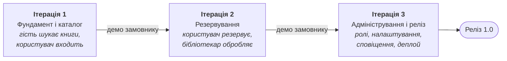
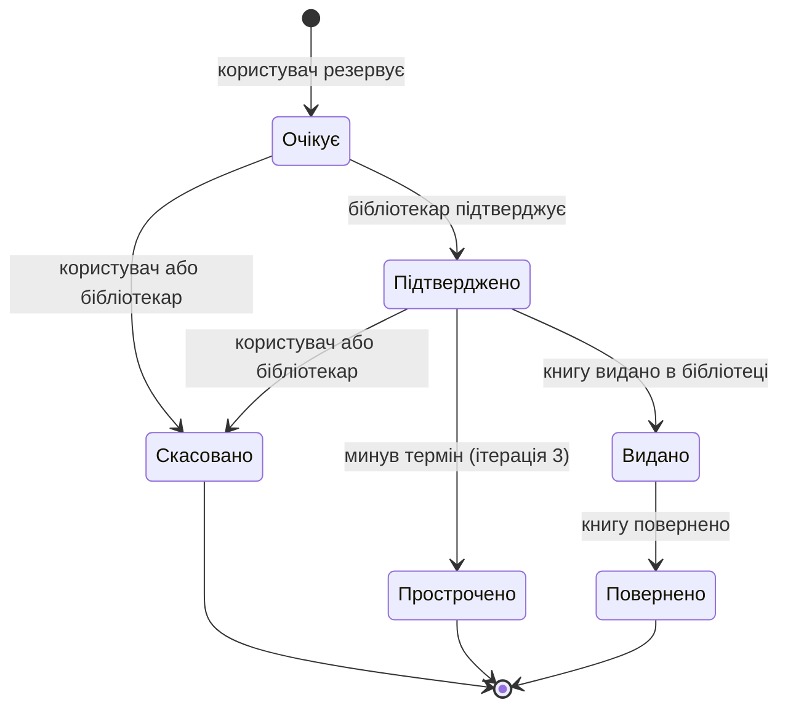

# Ітерації розробки

План розробки **Library Book Reservation System** розбитий на три ітерації за ітеративним підходом (спіральна модель / RUP). Кожна ітерація закінчується робочою версією системи, яку можна показати замовнику та отримати зворотний зв’язок.

Документ спирається на [REQUIREMENTS.MD](REQUIREMENTS.MD), [SPECIFICATION.md](SPECIFICATION.md), [USER_STORIES.md](USER_STORIES.md) та [USE_CASE_DIAGRAM.md](USE_CASE_DIAGRAM.md). Вимоги та обмеження позначені ID зі специфікації (FR — функціональні, NFR — нефункціональні, C — обмеження), пріоритети: **M** — Must, **S** — Should, **C** — Could.

## Дорожня карта

| Ітерація | User Stories | Use Cases | Ролі |
|----------|--------------|-----------|------|
| 1. Фундамент і каталог | 1. Перегляд каталогу, 2. Пошук і фільтрація | Перегляд каталогу книг, Пошук та фільтрація книг | Гість, Користувач |
| 2. Резервування | 3. Резервування книги, 4. Обробка резервувань | Резервування книги, Керування резервуваннями, Керування каталогом книг | Користувач, Бібліотекар |
| 3. Адміністрування і реліз | 5. Керування користувачами та ролями | Керування користувачами та ролями | Адміністратор |

Кожна ітерація проходить чотири кроки спіралі:

**Вимоги, що діють у кожній ітерації:** інтерфейс українською мовою (NFR-14), код на TypeScript з перевіркою лінтером (NFR-18), зрозумілі повідомлення про помилки без технічних деталей (NFR-11), збір лише необхідних персональних даних — ім’я та email (C-09).

---

## Ітерація 1 — Фундамент і каталог

**Мета:** закласти основу проєкту та дати змогу переглядати і шукати книги.

**Поточний стан:** у `application/` налаштовано Nuxt 4 + TypeScript, ESLint (`@nuxt/eslint`), Tailwind CSS, тему (шрифти Onest і Unbounded, кольори, тіні), базовий layout із шапкою та перші UI-компоненти (`BaseInput`, `FormInput`, `PasswordInput`, `BaseCta`, `BaseLogo`). БД, автентифікації та сторінок каталогу ще немає; `application/README.md` поки що стандартний шаблон Nuxt.

**Що робимо:**

- Налаштування проєкту: Nuxt + TypeScript, лінтер, базова розмітка та тема (C-01, NFR-18).
- Реляційна БД і схема таблиць: книги, користувачі (з полем ролі та ознакою блокування), резервування; запити лише через ORM або параметризовані запити для захисту від SQL-ін’єкцій (C-03, NFR-07).
- Реєстрація з ім’ям, email і паролем, перевірка унікальності email, вхід і вихід, хешування паролів (bcrypt або argon2), завершення сесії після 24 годин неактивності (FR-01 – FR-03, NFR-04, NFR-08).
- Каталог з пагінацією та сторінка книги: назва, автор, жанр, рік видання, ISBN, опис, обкладинка, кількість доступних примірників (FR-06, FR-07).
- Пошук за назвою й автором, фільтри за жанром, роком видання та доступністю (FR-08, FR-09).
- Тестові дані (seed): книги каталогу, а також облікові записи бібліотекаря й адміністратора, бо панель керування ролями з’явиться лише в ітерації 3.
- Інструкція із запуску в README (NFR-20).

**Результат:**

- Гість відкриває каталог, шукає та фільтрує книги, переглядає сторінку книги.
- Гість може зареєструватися, користувач — увійти та вийти.
- Схема БД готова для резервувань і ролей.
- Проєкт запускається за інструкцією з README.

**Ризики:**

| Ризик | Як зменшуємо |
|-------|--------------|
| Невдалий вибір БД / ORM, який доведеться міняти пізніше | Обрати рішення на початку (PostgreSQL або SQLite, C-03), спроєктувати схему одразу з таблицею резервувань і ролями |
| Помилки в автентифікації (небезпечне зберігання паролів, сесій) | Готова бібліотека для хешування, перевірка сесії на сервері |
| Команда витрачає час на налаштування замість функцій (C-08) | Обмежити ітерацію лише Must-вимогами, дизайн мінімальний |

---

## Ітерація 2 — Резервування та робота бібліотекаря

**Мета:** реалізувати головну функцію системи — резервування книг та їх обробку бібліотекарем.

**Що робимо:**

- Ролі та перевірка прав на сервері для кожного захищеного запиту; адміністратор має всі права бібліотекаря (NFR-05).
- Керування каталогом бібліотекарем: додавання, редагування, видалення книги без активних резервувань, зміна кількості примірників, перевірка обов’язкових полів і формату ISBN (FR-11 – FR-15).
- Створення резервування лише за наявності вільного примірника, зменшення кількості примірників в одній транзакції, заборона двох активних резервувань однієї книги (FR-16 – FR-18, NFR-10, C-07).
- Статуси резервування та повернення примірника в доступні після скасування або завершення (FR-22, FR-24).
- «Мої резервування» і скасування, поки резервування не має статусу «Видано» (FR-20, FR-21).
- Панель бібліотекаря: список резервувань із фільтрами за статусом, користувачем і книгою; підтвердження, скасування, позначення видачі та повернення (FR-25 – FR-27).
- Резервування не більше ніж за 3 дії від сторінки книги (NFR-13).
- Автотести бізнес-логіки: резервування, зміна статусів, перевірка прав (NFR-19).

**Переходи між статусами резервування** (FR-21 – FR-24, FR-26, FR-27):

Під час переходу в «Скасовано», «Прострочено» або «Повернено» примірник повертається в доступні.

**Результат:**

- Повний цикл: користувач резервує книгу → бібліотекар підтверджує → видає → приймає повернення.
- Кількість доступних примірників завжди коректна, зокрема за одночасних запитів.
- Функції доступні лише ролям, яким вони дозволені.

**Ризики:**

| Ризик | Як зменшуємо |
|-------|--------------|
| Два користувачі одночасно резервують останній примірник (NFR-10) | Атомарне оновлення в транзакції, окремий тест на цей сценарій |
| Логіка статусів стає заплутаною, з’являються неможливі переходи | Перевіряти переходи на сервері за діаграмою станів вище, тест для кожного переходу |
| Перевірка прав лише в інтерфейсі | Middleware на сервері для кожного захищеного маршруту |
| Замовник змінює правила резервування після демо | Показати прототип сторінок резервування на початку ітерації |

---

## Ітерація 3 — Адміністрування, сповіщення та реліз

**Мета:** завершити систему, додати адміністрування й автоматизацію та підготувати реліз.

**Що робимо:**

- Панель адміністратора: список користувачів із пошуком, зміна ролей, блокування й розблокування; заблокований користувач не може входити та резервувати (FR-31 – FR-33).
- Налаштування системи: ліміт активних резервувань на користувача (за замовчуванням 5) і термін дії резервування (за замовчуванням 3 дні) (FR-19, FR-34).
- Автоматичне прострочення підтверджених резервувань і повернення примірника в доступні (FR-23).
- Сповіщення в інтерфейсі про зміну статусу резервування (FR-29).
- Профіль користувача, сортування каталогу за назвою, автором і датою додавання, інформація про користувача для бібліотекаря (FR-04, FR-10, FR-28).
- Продуктивність: сторінки до 2 с, API пошуку до 500 мс на 10 000 книг, 100 одночасних користувачів (NFR-01 – NFR-03).
- Безпека: захист від XSS і CSRF, обмеження спроб входу — 5 за 15 хвилин (NFR-07, NFR-09).
- Доступність WCAG 2.1 AA, адаптивність від 360 px, дві останні версії Chrome, Firefox, Safari та Edge (NFR-15 – NFR-17).
- Деплой через HTTPS і щоденний бекап БД (NFR-06, NFR-12).
- За наявності часу: відновлення пароля та email-сповіщення (FR-05, FR-30).

**Результат:**

- Готова до використання версія 1.0, розгорнута на сервері.
- Адміністратор керує користувачами та налаштуваннями без змін у коді.
- Система працює на ПК, планшетах і мобільних пристроях.

**Ризики:**

| Ризик | Як зменшуємо |
|-------|--------------|
| Не вистачає часу на всі вимоги (C-08) | Could-вимоги (FR-05, FR-30) переносяться за межі релізу без шкоди для системи |
| Фонова задача прострочення працює ненадійно | Перевіряти прострочення також під час запитів, тест на зміну статусу |
| Проблеми під час деплою (середовище, БД, HTTPS, бекапи) | Пробний деплой на початку ітерації, а не в кінці |
| Інтерфейс незручний на мобільних | Перевірка на ширині 360 px після кожної нової сторінки |

---

## Відповідність вимог ітераціям

| Ітерація | Функціональні вимоги | Нефункціональні вимоги | Обмеження |
|----------|----------------------|------------------------|-----------|
| 1 | FR-01 – FR-03, FR-06 – FR-09 | NFR-04, NFR-07 (SQL-ін’єкції), NFR-08, NFR-18, NFR-20 | C-01, C-03 |
| 2 | FR-11 – FR-18, FR-20 – FR-22, FR-24 – FR-27 | NFR-05, NFR-10, NFR-13, NFR-19 | C-07 |
| 3 | FR-04, FR-05, FR-10, FR-19, FR-23, FR-28 – FR-34 | NFR-01 – NFR-03, NFR-06, NFR-07 (XSS, CSRF), NFR-09, NFR-12, NFR-15 – NFR-17 | — |
| Усі | — | NFR-11, NFR-14 | C-08, C-09 |

**Поза межами релізу 1.0** (за обмеженнями специфікації): мобільні застосунки (C-02), інтеграція з АБІС і зовнішніми каталогами (C-04), мережа філій (C-05), онлайн-оплати, штрафи та електронна видача (C-06), черга очікування на зайняті книги (C-07).
