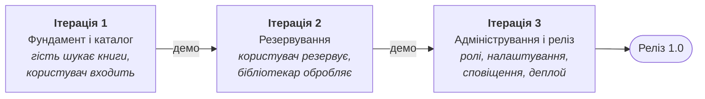
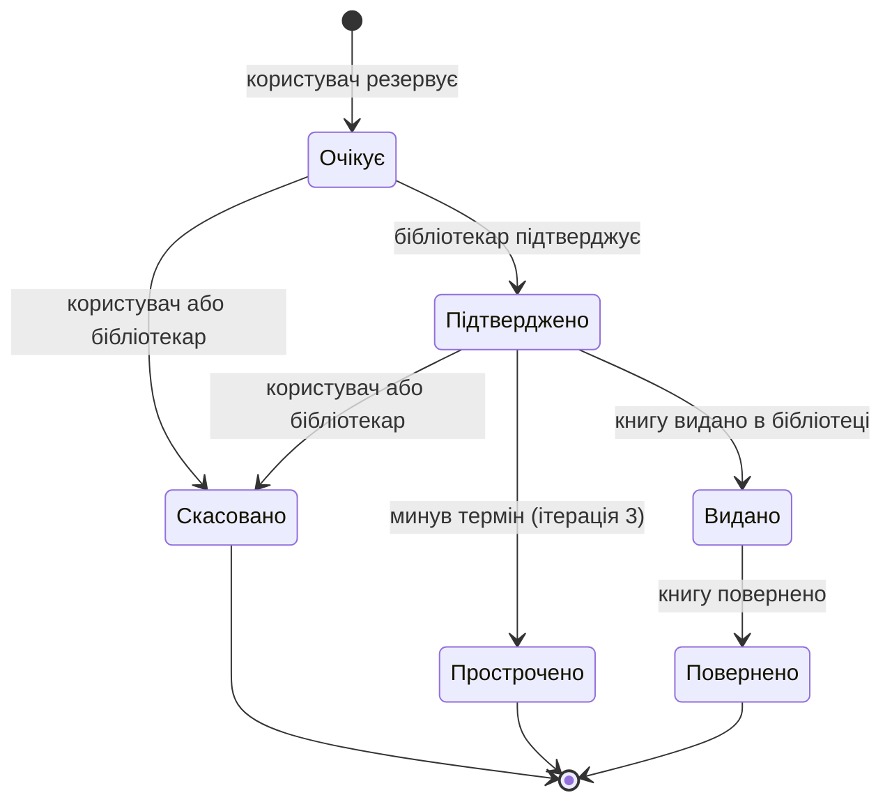

# Ітерації розробки

План розробки **Library Book Reservation System** розбитий на три ітерації за ітеративним підходом. Кожна ітерація закінчується робочою версією системи, яку можна продемонструвати.

## Дорожня карта

| Ітерація                   | User Stories | Ролі                    |
| -------------------------- | ------------ | ----------------------- |
| 1. Фундамент і каталог     | 1, 2         | Гість, Користувач       |
| 2. Резервування            | 3, 4         | Користувач, Бібліотекар |
| 3. Адміністрування і реліз | 5            | Адміністратор           |

Кожна ітерація проходить чотири кроки:

У всіх ітераціях інтерфейс робимо українською мовою, а помилки показуємо користувачу зрозумілими повідомленнями.

---

## Ітерація 1 — Фундамент і каталог

**Мета:** створити основу проєкту і зробити каталог книг з пошуком.

**Що вже зроблено:** створено Nuxt-проєкт з TypeScript, ESLint, додано базові модулі для роботи.

**Що робимо:**

- Налаштування проєкту: Nuxt, TypeScript, лінтер, тема.
- База даних і таблиці: книги, користувачі, резервування.
- Реєстрація, вхід і вихід, паролі зберігаються у вигляді хешу.
- Каталог з пагінацією і сторінка книги.
- Пошук за назвою та автором, фільтри за жанром, роком і доступністю.
- Тестові дані: книги, а також акаунти бібліотекаря та адміністратора, бо керування ролями буде тільки в 3 ітерації.
- Інструкція із запуску в README.

**Результат:**

- Гість може переглядати каталог, шукати та фільтрувати книги.
- Користувач може зареєструватися, увійти та вийти.
- База даних готова для резервувань.

**Ризики:**

| Ризик                                              | Що робимо                                                 |
| -------------------------------------------------- | --------------------------------------------------------- |
| Неправильно обрана БД, яку потім доведеться міняти | Обрати БД на початку і одразу додати таблицю резервувань  |
| Помилки в авторизації                              | Використати готову бібліотеку для хешування паролів       |
| Багато часу йде на налаштування             | Робити тільки обов’язкові вимоги, дизайн поки мінімальний |

---

## Ітерація 2 — Резервування та робота бібліотекаря

**Мета:** зробити резервування книг і панель для бібліотекаря.

**Що робимо:**

- Ролі та перевірка прав на сервері.
- Бібліотекар може додавати, редагувати і видаляти книги та змінювати кількість примірників.
- Створення резервування: кількість вільних примірників зменшується, одну книгу не можна зарезервувати двічі.
- Статуси резервування.
- Сторінка «Мої резервування» і скасування резервування.
- Панель бібліотекаря: список резервувань з фільтрами, підтвердження, скасування, видача і повернення книги.
- Тести для логіки резервувань.

**Статуси резервування:**

Коли резервування скасоване, прострочене або книгу повернули, примірник знову стає доступним.

**Результат:**

- Користувач резервує книгу, бібліотекар підтверджує, видає і приймає її назад.
- Кількість доступних примірників рахується правильно.
- Кожна роль бачить тільки свої функції.

**Ризики:**

| Ризик                                                            | Що робимо                                           |
| ---------------------------------------------------------------- | --------------------------------------------------- |
| Два користувачі одночасно резервують останній примірник | Робити резервування в транзакції і написати тест    |
| Плутанина зі статусами                                           | Спочатку намалювати діаграму статусів, потім код    |
| Права перевіряються тільки на фронтенді                          | Перевіряти права на сервері через middleware        |
| Замовник хоче змінити правила резервування                       | Показати замовнику сторінки резервування на початку |

---

## Ітерація 3 — Адміністрування, сповіщення та реліз

**Мета:** доробити адмінку, сповіщення і викласти проєкт на сервер.

**Що робимо:**

- Панель адміністратора: список користувачів, зміна ролей, блокування.
- Налаштування: ліміт резервувань і термін резервування.
- Автоматичне прострочення резервувань.
- Сповіщення про зміну статусу резервування.
- Профіль користувача, сортування каталогу, інформація про користувача для бібліотекаря.
- Адаптивна верстка, швидкість роботи, захист від XSS і CSRF, обмеження спроб входу.
- Деплой з HTTPS і бекапи бази даних.
- Якщо залишиться час: відновлення пароля та email-сповіщення.

**Результат:**

- Готова версія 1.0 на сервері.
- Адміністратор може керувати користувачами і налаштуваннями.
- Сайт працює на комп’ютері і на телефоні.

**Ризики:**

| Ризик                                  | Що робимо                                                        |
| -------------------------------------- | ---------------------------------------------------------------- |
| Не встигаємо зробити все        | Необов’язкові вимоги можна перенести після релізу |
| Прострочення резервувань не спрацьовує | Додатково перевіряти термін при запитах і написати тест          |
| Проблеми з деплоєм                     | Зробити пробний деплой на початку ітерації                       |
| Незручно користуватися з телефону      | Перевіряти кожну нову сторінку на ширині 360 px                  |

---

## Що не входить у проєкт

За обмеженнями зі специфікації ми не робимо мобільний застосунок, інтеграцію з іншими бібліотечними системами, підтримку кількох філій, оплати і штрафи та чергу на зайняті книги.
